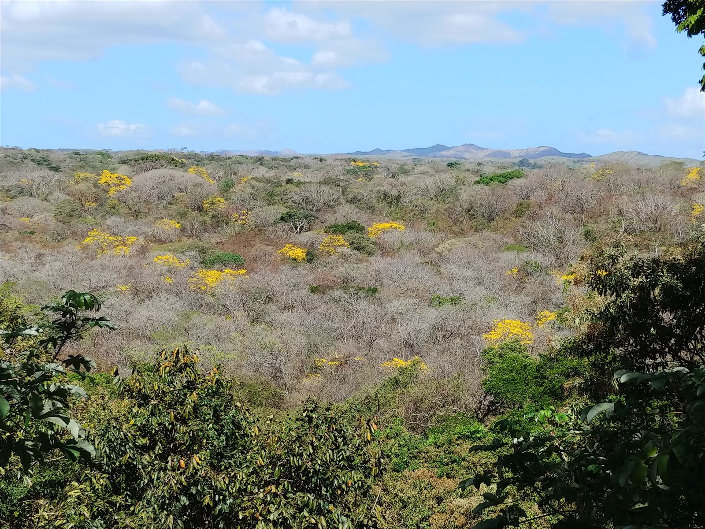
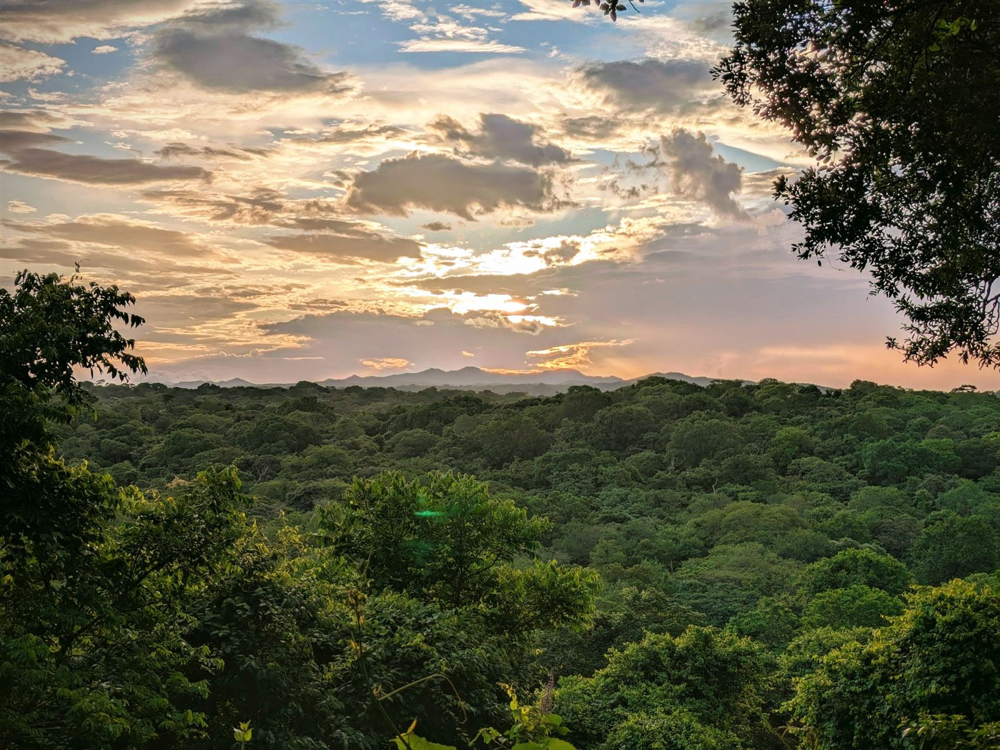
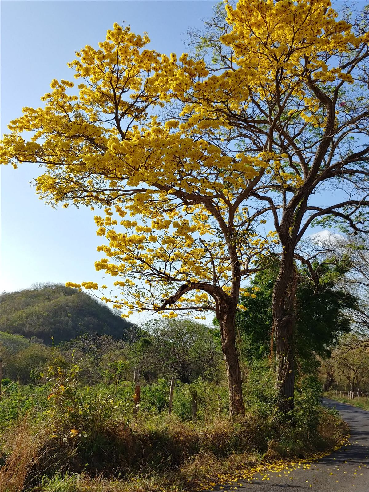
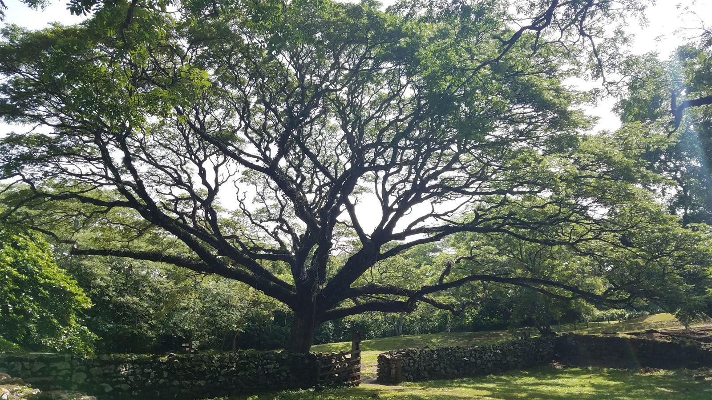
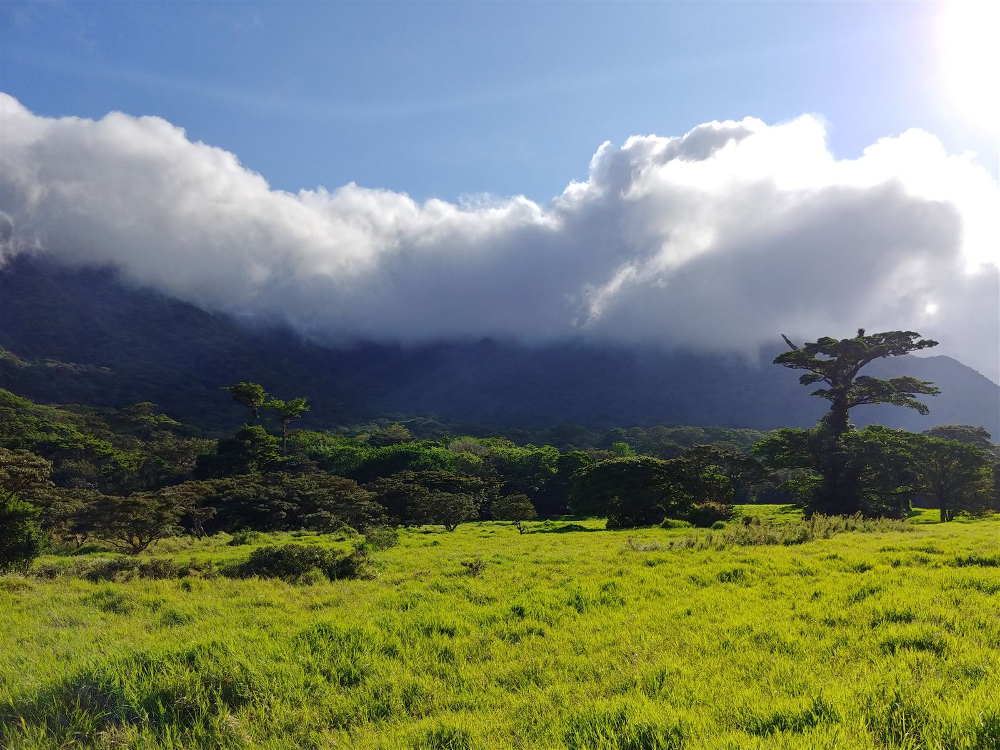
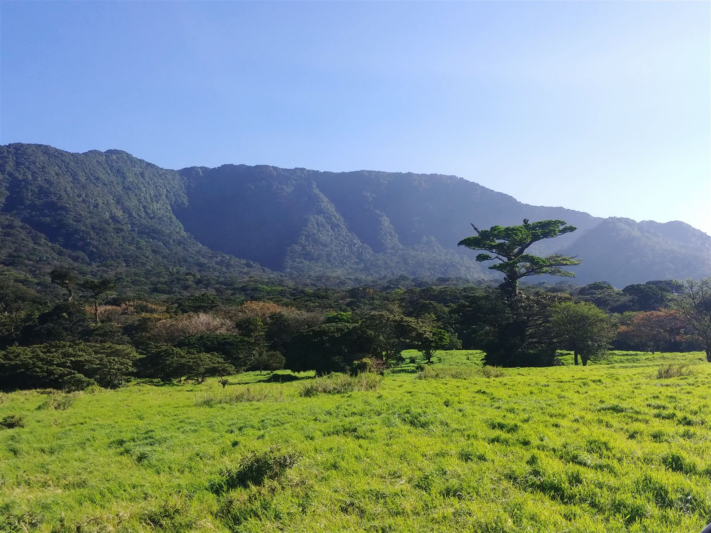
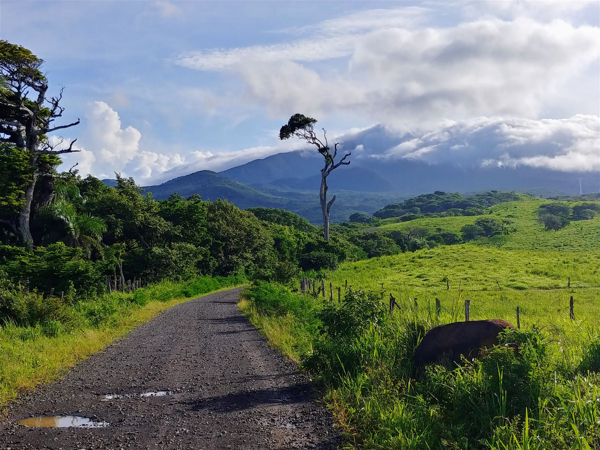
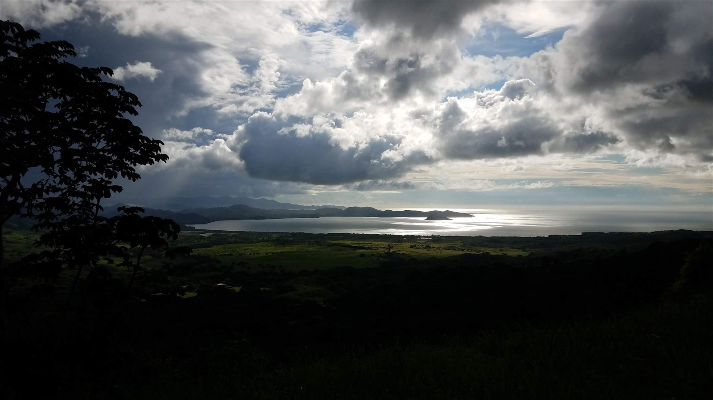
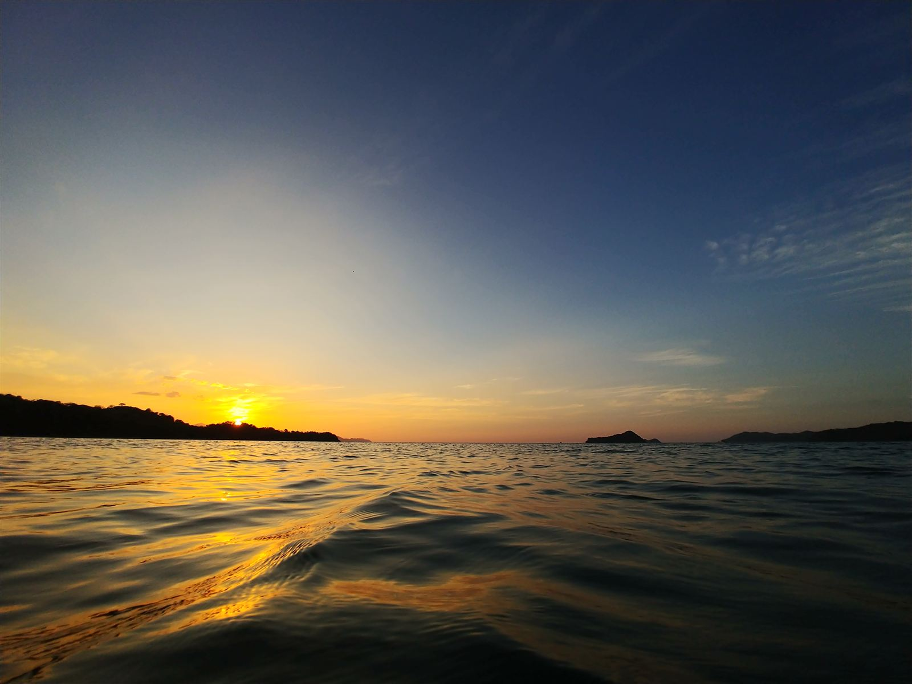

Hola, soy Catherine Hulshof, ecóloga de Virginia Commonwealth University. Área de Conservación Guanacaste es un lugar al que siempre vuelvo, como investigadora y como docente, y es uno de los paisajes tropicales más estudiados del mundo.

**Por qué lo construí.** En ACG se han hecho décadas de trabajo: cientos de miles de orugas criadas, bosques que se siguen mientras se regeneran de potreros, tortugas marinas, monos, volcanes, arrecifes. Pero los resultados están dispersos en cientos de revistas, tesis y repositorios de datos. Quería un solo lugar donde cualquier persona (un estudiante en Liberia, un parataxónomo, una investigadora visitante, o yo misma antes de empezar un proyecto) pueda ver qué se ha hecho aquí y encontrar los datos que lo respaldan.

**Qué es y qué no es.** El ACG Atlas es un índice, no un repositorio. Tiene dos partes, que se buscan por separado pero están construidas igual: **datos** (conjuntos de datos en archivos permanentes) y **publicaciones** (trabajos sobre investigación hecha en ACG). Cada entrada enlaza a su sitio permanente, con su propio DOI, licencia y cita. Complementa los sistemas de información propios de ACG; no los reemplaza.

**Cómo llegan los datos.** Cada semana el sitio busca en DataCite (que incluye Dryad, Zenodo, EDI, Figshare, PANGAEA y más) y en GBIF (con el límite de ACG), y cualquier investigador puede agregar los suyos en la página [Contribuir](contribuir.qmd). Reviso cada entrada antes de publicarla.

**Cómo llegan las publicaciones.** Busqué nombres de lugares de ACG en Web of Science y OpenAlex, y luego leí títulos y resúmenes. Se incluye una publicación si la investigación se hizo en ACG (cualquier sector, incluido el marino), usa especímenes o datos de ACG, o trata principalmente sobre ACG. Los registros vienen de OpenAlex (CC0) o Crossref; no se copia nada de Web of Science. Cada semana se encuentran nuevas publicaciones automáticamente, y usted puede sugerir las que me falten. La estrategia de búsqueda completa está [en GitHub](https://github.com/acg-atlas/acg-data-catalog/blob/main/data-raw/literature_search.md).

**Puede haber errores.** Con más de mil entradas etiquetadas en parte por reglas y en parte a mano, algunas estarán mal o faltarán. Si encuentra una, avíseme en la página [Contribuir](contribuir.qmd) o en un [issue de GitHub](https://github.com/acg-atlas/acg-data-catalog/issues).

**Créditos.** Cada conjunto de datos y cada publicación pertenece a sus autores; por favor cite el trabajo original, con su DOI. La capa del límite de ACG es cortesía de SIG-ACG (Waldy Medina), CC BY 4.0. Los mosaicos del mapa vienen de la API de mapas de GBIF y de Esri.

**Abierto por diseño.** Todo el código y las decisiones de curaduría son públicos en [github.com/acg-atlas](https://github.com/acg-atlas).

## ACG a lo largo de las estaciones

<figure><figcaption>El bosque seco desde el mirador en la época seca, con árboles en flor amarilla</figcaption></figure>
<figure><figcaption>La misma vista en la época lluviosa, al atardecer</figcaption></figure>
<figure class="tall"><figcaption>Corteza amarilla (Tabebuia ochracea) en flor</figcaption></figure>
<figure><figcaption>Un cenízaro gigante (Samanea saman)</figcaption></figure>
<figure><figcaption>Nubes sobre el Volcán Cacao</figcaption></figure>
<figure><figcaption>El Volcán Cacao sobre los potreros</figcaption></figure>
<figure><figcaption>El camino a Góngora</figcaption></figure>
<figure><figcaption>Luz de tormenta sobre la bahía</figcaption></figure>
<figure><figcaption>Atardecer en Junquillal</figcaption></figure>

Fotos © Catherine Hulshof. Por favor pregunte antes de reutilizarlas.

